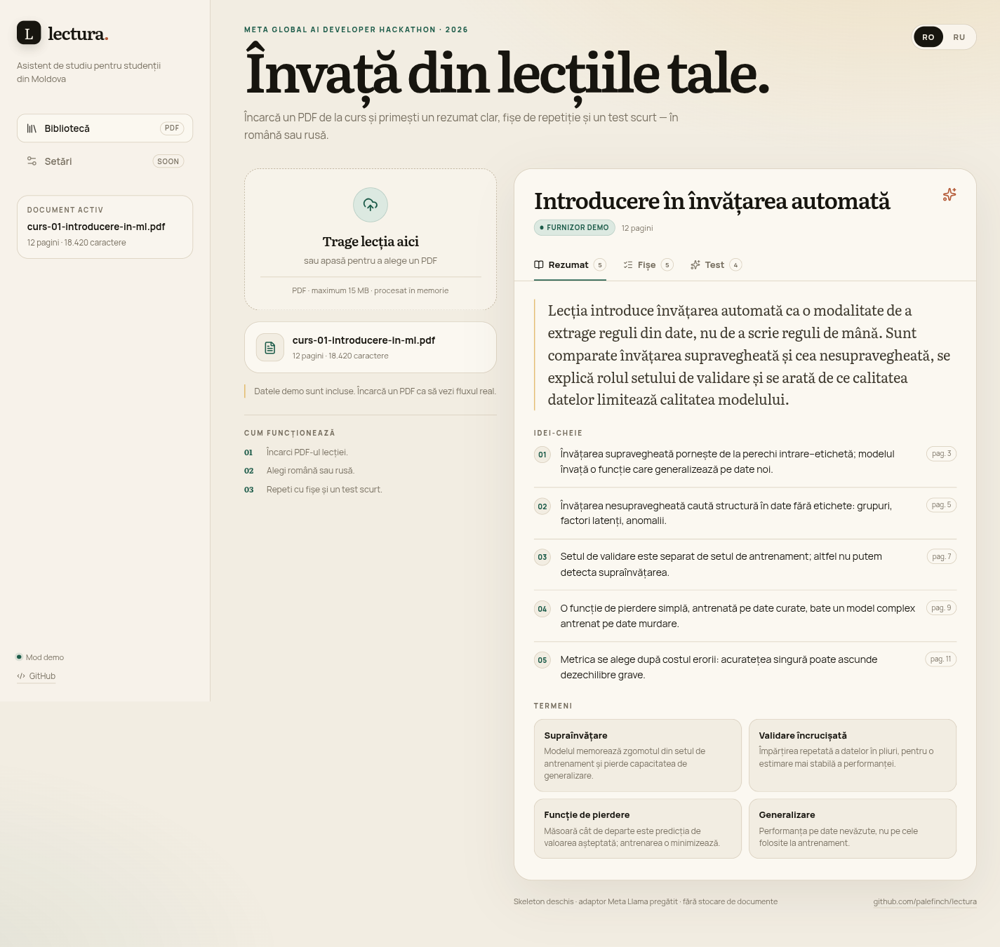
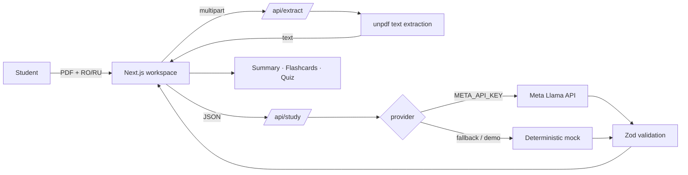

# lectura.

**Asistent de studiu bilingv RO/RU pentru lecții în PDF.**  
**Двуязычный учебный ассистент для лекций в PDF.**

> Skeleton pentru **Meta Global AI Developer Hackathon 2026**, track Indie Dev.
> Conectează un PDF de la curs și primești rezumat, fișe de repetiție și un test scurt — în română sau rusă.

[](https://github.com/palefinch/lectura/actions/workflows/ci.yml)
[](LICENSE)



---

## De ce

Studenții din Moldova învață din PDF-uri în română și rusă, dar instrumentele de studiu sunt de obicei într-o singură limbă și nu au nicio legătură cu cursul real. Lectura ia lecția ta și o transformă într-un pachet de studiu compact, cu trimiteri la pagini.

**Ce face skeleton-ul:**

- extrage text din PDF în browser-server, fără să-l stocheze;
- generează un pachet structurat: rezumat, idei-cheie, termeni, fișe, test;
- păstrează aceeași lecție în RO și RU;
- funcționează imediat în **mod demo**, fără chei API;
- are un adaptor gata pentru **Meta Llama API** (endpoint OpenAI-compatible).

## Demo rapid

```bash
npm install
cp .env.example .env.local   # opțional: pune META_API_KEY
npm run dev
```

Deschide [http://localhost:3000](http://localhost:3000). Pagina pornește cu o lecție demo despre învățarea automată. Trage un PDF în zona de upload pentru fluxul real.

Fără `META_API_KEY`, provider-ul mock construiește un pachet rezonabil din primele propoziții ale textului. Cu cheia, adaptorul trimite textul la Meta Llama API și validează răspunsul cu Zod; dacă apelul eșuează, revine la mock fără să spargă demo-ul.

## Arhitectură



**Stack:** Next.js 16 (App Router) · React 19 · TypeScript · CSS custom properties · `unpdf` · Zod · Vitest.

**De ce așa:**

- un singur deploy, fără infra separată în timpul hackathon-ului;
- route handlers țin cheia API pe server, niciodată în bundle-ul client;
- provider-ul e izolat într-un singur fișier, deci schimbarea modelului nu atinge UI-ul;
- mock-ul determinist face demo-ul reproductibil chiar și fără rețea.

## API

| Endpoint | Metodă | Ce face |
|---|---|---|
| `/api/health` | `GET` | status, provider activ, model |
| `/api/extract` | `POST` | `multipart/form-data`: `file`, `lang` → text + metadate |
| `/api/study` | `POST` | `{ text, lang, title? }` → `{ pack, provider }` |

Contractul `StudyPack` este definit în [`lib/types.ts`](lib/types.ts) și validat cu Zod în [`lib/ai/schema.ts`](lib/ai/schema.ts).

## Configurare

| Variabilă | Default | Rol |
|---|---|---|
| `META_API_KEY` | gol | cheia Meta Llama API; fără ea rulează mock-ul |
| `META_API_BASE_URL` | `https://api.llama.com/compat/v1` | endpoint OpenAI-compatible |
| `META_MODEL` | `Llama-4-Maverick-17B-128E-Instruct-FP8` | modelul folosit |
| `DEMO_MODE` | `false` | forțează mock-ul chiar și cu cheie |
| `MAX_INPUT_CHARS` | `24000` | limita de text trimisă la model |

Cheia stă doar în `.env.local` (ignorat de git) sau în environment-ul platformei. Nu o pune în `NEXT_PUBLIC_*`.

## Structură

```text
app/
  api/extract/route.ts     # PDF -> text
  api/study/route.ts       # text -> StudyPack
  page.tsx                 # workspace
  globals.css              # design system "paper & ink"
components/
  workspace.tsx            # stare, upload, taburi
  summary-panel.tsx
  flashcards-panel.tsx
  quiz-panel.tsx
lib/
  ai/provider.ts           # Meta + fallback
  ai/prompts.ts            # prompturi + mock
  ai/schema.ts             # contract Zod
  demo.ts                  # lecția demo RO/RU
  pdf.ts                   # unpdf
docs/
  ARCHITECTURE.md
  DEMO.md
  ROADMAP.md
```

## Verificare

```bash
npm run typecheck
npm test
npm run build
```

CI rulează aceleași trei comenzi pe fiecare push și pull request.

## Confidențialitate

- PDF-ul este citit în memorie în route handler; nu se scrie pe disc și nu se loghează textul.
- Textul este trimis la provider doar când `META_API_KEY` este configurat.
- Nu există conturi, analytics sau cookies în skeleton.
- Pentru producție: adaugă rate limiting, limită de dimensiune la edge/proxy și un policy de retenție.

## Ce nu este încă aici

- OCR pentru PDF-uri scanate;
- chunking + embeddings pentru lecții mai lungi de 24k caractere;
- persistență, conturi și sincronizare între device-uri;
- spaced repetition și analytics;
- integrare cu Moodle/Google Classroom.

Vezi [`docs/ROADMAP.md`](docs/ROADMAP.md) pentru planul de 10 zile și pașii de producție.

## Licență

MIT. Proiect de hackathon; nu este afiliat cu Meta.
